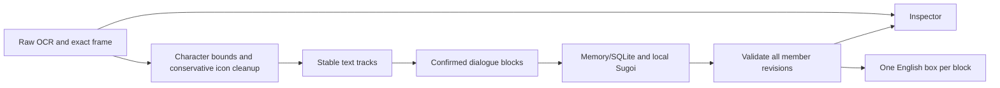

# Architecture

## Current implementation

`app` assembles the Windows boundary, QApplication, main window, and lazy OCR/translation factories.
`ui` owns controls and coordination for one capture/OCR/translation session. `inspection` owns the
image/text inspector. `capture` owns asynchronous native capture and shutdown.
`overlay` owns rendering and display placement. `windows` owns Win32 identity, geometry, and
overlay styles. `domain` contains immutable shared values and pure geometry/visibility policy.
`demo` is an optional animated test target.

The domain imports no Qt or Windows code. Capture does not depend on Qt and consumes a small
geometry-source protocol. `recognition` owns the OCR worker, immutable observations, and lifecycle;
it imports no Qt, Win32, or model runtime. `meiki` isolates pinned MeikiOCR/ONNX details. `models`
defines and validates pinned local assets. `tracking` owns bounded text identities, matching,
confirmation, and expiration; it stores no frame images and has no native/model dependencies.
`translation` owns scheduling, backend swaps, and result validity through a small backend protocol.
`sugoi` owns SentencePiece/CTranslate2 and pinned translation assets; `translation_cache` owns bounded
memory/SQLite storage. `text_layout` owns measured English wrapping and viewport limits. The current
single-session coordinator can move out of the UI when a second consumer requires it.

## Coordinates

All rectangles crossing native/capture boundaries use physical pixels. Client and window bounds
are desktop coordinates, including negative monitor origins. Startup requests per-monitor V2 DPI
awareness before creating any windows. Capture checks actual image dimensions against DWM visible
bounds, window bounds, and client bounds. It crops only a matching, containing rectangle; resize
frames whose geometry does not agree are discarded.

The overlay HWND is positioned with SetWindowPos in physical client coordinates. Painting scales
by the inverse of the overlay's current devicePixelRatioF. This avoids incorrectly scaling desktop
origins when monitors have different DPI. A retained frame may follow a window move but cannot be
used to display an overlay after a client-size change until a compatible new frame arrives.

## Ownership and lifecycle

The GUI thread owns all Qt widgets. A Python capture-owner thread creates and stops the native
capture session. The native callback obtains current geometry, throttles copies, crops, and copies
borrowed native memory into owned immutable bytes before returning. It catches exceptions before
crossing the native boundary.

A lock protects one replaceable frame snapshot. The UI polls snapshots and redraws the preview
only when its sequence changes. There is no growing frame queue. Native startup, imports, and
shutdown never run on the GUI thread. Stop requests immediately hide the overlay and clear the
preview; the UI polls completion before allowing another session or finishing application close.

Each session is single-use and tied to HWND plus process ID. Terminal states reject late frame
publication. Failure diagnostics survive cleanup. A new session receives a new mailbox, preventing
old callbacks from modifying its state. Initial capture without a usable frame times out after ten
seconds. An unchanged WGC source need not deliver repeated frames, so frame age alone is not a
failure signal. Window validity, minimize state, focus, and current geometry are checked separately.

## Overlay behavior

Qt and Win32 both mark the overlay as input-transparent and nonactivating. The layered-window
style supports mouse pass-through across processes. WDA_EXCLUDEFROMCAPTURE is required; failure
stops the session with a visible explanation. The overlay is visible only for the selected foreground
window with matching capture dimensions. It hides on focus loss, minimize, stop, or source failure.

English mode draws translated text over a translucent background at committed track positions.
Untranslated/pending regions leave the original game text visible. English always uses stabilization.
Turning English off reveals numbered OCR boxes for diagnosis; only this mode allows raw box comparison.
The default stabilized mode retains committed positions through small OCR changes and brief misses.
An unchanged source frame can retain its boxes indefinitely. Advancing capture without fresh matching
OCR expires tracks after 800 ms; two consecutive missed OCR observations also remove a track.
Dimension mismatches always hide/clear them. The comparison checkbox displays raw boxes with the
original 750 ms freshness policy. The original sample mode remains for the native regression harness.

`OverlayWindow.set_tracks` and `set_translations` compare immutable display values rather than fresh
OCR object identity. Changed display values/style request an application repaint. Qt/Windows can
still repaint for expose, resize, DPI, and other native reasons. Holding a box is not a promise to
suppress all paint events.

## OCR ownership and inspection

Each capture session gets one OCR worker and model instance. The worker imports the model runtime,
validates files, and loads all three ONNX sessions off the GUI thread. It processes one frame at a
time with at most one replaceable pending frame and one published result. No inference backlog
accumulates. The CPU provider uses two intra-op threads per session, one inter-op thread, disabled
idle spinning, OpenCV one thread, and recognition batches of four. Models execute sequentially.

Resize, minimize, and pause increment a generation and clear pending/published work. Already-running
native inference finishes, but cannot publish into an invalid generation. Each new capture has a
separate worker. Stop clears the inspector and overlay immediately; the GUI polls all workers'
completion before restarting or closing. A model failure preserves its diagnostic while capture
continues; stop/start retries loading. There is no forced interruption of an ONNX call.

An `OcrResult` retains its exact source frame, text regions, character boxes/scores, inference duration,
and completion time. OCR coordinates are client-relative physical pixels. Meiki performs internal
detector scaling; its outputs already refer to the original input dimensions. The inspector uses
one image transform for both pixels and boxes, including letterboxing and zoom. Recognition is not
filtered to Japanese, so other visible text may also appear. Detector-only boxes survive empty
recognition. Displayed confidence is the mean retained-character score; detection scores are not
exposed by the pinned upstream implementation.

Pause freezes the current image/table and invalidates queued work while capture continues. Resume
resubmits the latest frame. Resize/minimize/stop clear even a frozen inspection to prevent a stale
source from appearing active. Tracking resets on these events and on failure; IDs are never reused
during the tracker object's lifetime. The raw inspector remains independent of smoothed display data.

## Text tracking

`text_content.content_region` derives tracking observations without changing the raw `OcrResult`.
When character metadata covers the whole recognized string, its union supplies text bounds instead
of the detector's potentially icon-inclusive rectangle. For horizontal text, one or two isolated,
weak edge glyphs beside a strong Japanese run may be excluded from that derived observation.
Structural punctuation, numbers, interior characters, incomplete metadata, and uncertain cases
remain intact. The inspector still displays original detector/character boxes, text, and scores.

The GUI coordinator observes each completed OCR sequence once; repeated polling cannot count as
confirmation. All timestamps are explicit monotonic capture times. No background timer, history
queue, extra model, or image copy is introduced. Matching runs only on new OCR, bounded to 128 tracks
and 128 candidate regions. One-to-one greedy assignment uses overlap, spatial proximity, orientation,
and exact/approximate normalized text; ties are deterministic. Identical distant labels cannot match
on text alone. The raw inspector receives the assigned IDs in original detector row order.

Each track separates the latest observed geometry from committed display geometry and content.
Small edge changes inside a glyph-scaled deadband retain exactly the same `TextTrack` object.
Persistent modest shifts/crop changes require two observations; a large coherent translation of a
similarly-sized box moves immediately. Ordinary text edits require two consecutive observations
before incrementing `text_revision`. A near-identical reading at nearly the same position also
competes with the best character-mean confidence recorded for the committed text. Weaker/equal
variants retain the exact committed text and geometry; confidence fluctuations stay private and
cannot invalidate English or request a repaint. A confirmed higher-confidence variant becomes the
new preference. Similarity is conservative; numeric edits, short labels, and typewriter growth
keep the ordinary confirmation path.

A weaker similar candidate can still replace the preference after 1.25 seconds of consistent
evidence, resetting its confidence baseline. This prevents genuine one-character dialogue edits
from being hidden indefinitely. Returning to the winner, another candidate, a miss, or a long OCR
gap breaks that evidence. New content and expired/reset tracks do not inherit an old score.
Missing/invalid confidence falls back to ordinary confirmation. Raw inspector text/scores are unchanged.
If no newer frame arrives, ordinary pending changes settle after 350 ms on that latest captured
frame; protected weaker variants use the longer 1.25-second interval. WGC does not need to repeat
identical pixels. A long static pause preserves IDs without counting
pending edits on either side of the gap as consecutive evidence.

New recognized regions display immediately in diagnostic mode. Translation waits for a second
consistent observation, or 350 ms on an unchanged latest frame. Previously confirmed content remains
eligible through pending edits and the one-miss grace period, keeping its existing English visible.
A committed new revision invalidates its old English. Empty recognition remains visible in the raw
inspector but cannot refresh a track. Text tracking does not yet implement visual scene-cut detection,
optical flow, or split/merge reconciliation.
See [the policy decision](decisions/003-stable-display.md) for thresholds and tradeoffs.
The [confidence decision](decisions/005-confidence-stability.md) refines text acceptance without
changing public track values, translation/cache identities, or model ownership.

## Translation and layout

`grouping.DialogueGrouper` forms `TextBlock` values from stable lines. It requires nearby horizontal
lines of comparable height and left alignment, continuation/punctuation evidence, and an unambiguous
successor. Short/narrow speaker labels, marked choices, completed sentences, separate columns, and
vertical lines stay separate. Limits are six lines and 512 source characters per group. Every member
must be confirmed, and a group must keep its membership/source for 350 ms before translation. Single
lines retain their existing readiness policy. The checkbox disables grouping without resetting OCR.

Japanese wrapped lines join without invented punctuation or spaces; Latin word boundaries retain a
space. Requests contain the exact combined source plus every member's ID, revision, and individual
source, so moving a block cannot cause retranslation. The first member is its display anchor, not
its sole validity check. Splits, merges, member edits/removal, and toggle changes reject old replies.
The memory/SQLite key uses the exact combined source and existing backend identity; member geometry
does not enter that key. Resetting tracking also resets the bounded group-settling state.

The UI replaces the desired set of up to 128 confirmed Japanese blocks. One worker owns
one backend and one cache. It coalesces identical text into batches of at most four distinct sources;
there is no historical job queue. Non-Japanese regions remain available in the raw inspector but are
not submitted to the Japanese-to-English backend.

The worker checks the memory/SQLite cache, translates missing entries, and publishes only requests
still desired in the same generation. In-flight work can populate the cache after invalidation, but
cannot repopulate obsolete display results. Reset, pause, minimize, resize, and model switches
invalidate generations. The renderer independently matches the full request, including all members.

`TranslationBackend` exposes `cache_identity`, batched `translate`, and `close`. Factories are passed
from `app`; adding another engine needs an adapter and registration, not pipeline changes. The two
initial choices are Sugoi decoding profiles, not different model weights. Switching drains the active
call, unloads the old backend, then loads the latest selected backend on the same worker. No two
loaded models are deliberately retained. Stop is nonblocking; native calls finish before teardown.
Failure leaves OCR/capture running and presents a diagnostic; toggle English off/on to retry.

Sugoi uses pinned local weights, Japanese/English SentencePiece files, CPU int8, two threads, and
beam size two (Fast CPU) or five (Wider search). The adapter rejects overlong input or missing output
termination instead of silently truncating. There is no network fallback or automatic model setup.

Automatic text size estimates glyph height from stable bounds (width for vertical text), measures
Segoe UI in physical pixels, then allows limited shrinking/wrapping. Manual size fixes the pixel
size. Overflow can widen the box by up to 50%, add lines, and shift it inside the client viewport;
remaining overflow uses an ellipsis. Full English is retained in the inspector and clipboard.
Groups use the median individual line height for automatic sizing, not the whole paragraph height.
Layout is cached for 256 combinations. Adjacent-box collision resolution is not implemented.
English is horizontal even when its source is vertical.

The inspector continues to pair raw OCR with its exact frame. Its English column also requires
matching track ID and derived source text for every member. The anchor row shows the English;
continuation rows point to that group, and tooltips show its source and full translation. Copying
English from any member copies the complete group; copying all rows deduplicates by request.
A pending OCR edit may show no English in the table while the game holds the prior committed
translation. Pause freezes both table languages. Raw Japanese/boxes always remain inspectable.

## Runtime data

Images stay in memory. No screenshots are automatically saved. Bounded diagnostic logs live under
`%LOCALAPPDATA%/JPOverlay/logs`, with no normal logging of captured pixels or recognized text.
Dependencies and the launcher environment are project-local when using the bundled setup script.
Models live in ignored `models/meiki` (or `JP_OVERLAY_MODEL_DIR`) and `models/sugoi-v4`
(or `JP_OVERLAY_SUGOI_DIR`). Explicit setup scripts install them. Repository revisions, lengths, and
SHA-256 digests are pinned; runtime rejects missing/corrupt files without a network fallback.

Translation cache storage is ignored `data/translations.sqlite3`: at most 512 memory entries and
20,000 SQLite rows. Keys hash exact source plus language pair, weights/tokenizer revision, runtime
versions, decoding settings, and adapter version. English translations persist locally; screenshots
and raw Japanese are not written into this database. SQLite uses WAL on its owning worker. Disk
errors fall back to bounded memory with a visible warning and preserve the original file. There is
no Redis service. Future glossary/context features must extend cache identity before reuse.
