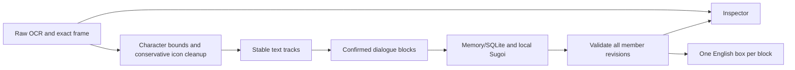

# Architecture

## Current implementation

`app` assembles the Windows boundary, QApplication, main window, and lazy OCR/translation factories.
`ui` owns coordination for one capture/OCR/translation session and the compact main window.
`settings_window` owns nonmodal configuration/setup views; `preferences` owns validated settings
and coalesced atomic persistence. `controls` and `theme` provide shared Qt presentation.
`inspection` owns the independent image/text inspector. `capture` owns native capture and shutdown.
`overlay` owns rendering and display placement. `windows` owns Win32 identity, geometry, and
overlay styles. `domain` contains immutable shared values and pure geometry/visibility policy.
`demo` is an optional animated test target.

The domain imports no Qt or Windows code. Capture does not depend on Qt and consumes a small
geometry-source protocol. `recognition` owns the OCR worker, immutable observations, and lifecycle;
it imports no Qt, Win32, or model runtime. `meiki` isolates pinned MeikiOCR details; `ocr_runtime`
owns provider/session construction and process-local NVIDIA DLL loading. `models`
defines and validates pinned local assets. `tracking` owns bounded text identities, matching,
confirmation, and retirement; it stores no frame images and has no native/model dependencies.
`presence` computes bounded exact crop digests; tracks retain only those digests and their bounds.
`translation` owns scheduling, backend swaps, and result validity through a small backend protocol.
`sugoi` owns SentencePiece/CTranslate2 and pinned translation assets; `gemma` owns optional embedded
llama.cpp, local QAT weights, bounded prompt/output and process-local CUDA 13 library setup.
`diagnostics` creates bounded read-only overlay snapshots from visual/OCR/translation state.
`translation_cache` owns bounded
memory/SQLite storage. `text_layout` owns measured English wrapping and viewport limits. The current
single-session coordinator can move out of the UI when a second consumer requires it.

## Coordinates

All rectangles crossing native/capture boundaries use physical pixels. Client and window bounds
are desktop coordinates, including negative monitor origins. Startup requests per-monitor V2 DPI
awareness before creating any windows. Capture checks actual image dimensions against DWM visible
bounds, window bounds, and client bounds. It crops only a matching, containing rectangle; resize
frames whose geometry does not agree are discarded.

The overlay HWND is positioned with SetWindowPos in physical client coordinates. Painting scales
by the inverse of the overlay's current devicePixelRatioF. This avoids incorrectly scaling desktop
origins when monitors have different DPI. A retained frame may follow a window move but cannot be
used to display an overlay after a client-size change until a compatible new frame arrives.

## Ownership and lifecycle

The GUI thread owns all Qt widgets. A Python capture-owner thread creates and stops the native
capture session. The native callback obtains current geometry, throttles copies, crops, and copies
borrowed native memory into owned immutable bytes before returning. It catches exceptions before
crossing the native boundary.

A lock protects one replaceable frame snapshot. The UI polls snapshots and redraws the preview
only when its sequence changes. There is no growing frame queue. Native startup, imports, and
shutdown never run on the GUI thread. Stop requests immediately hide the overlay and clear the
preview; the UI polls completion before allowing another session or finishing application close.

Each session is single-use and tied to HWND plus process ID. Terminal states reject late frame
publication. Failure diagnostics survive cleanup. A new session receives a new mailbox, preventing
old callbacks from modifying its state. Initial capture without a usable frame times out after ten
seconds. An unchanged WGC source need not deliver repeated frames, so frame age alone is not a
failure signal. Window validity, minimize state, focus, and current geometry are checked separately.

## Overlay behavior

Qt and Win32 both mark the overlay as input-transparent and nonactivating. The layered-window
style supports mouse pass-through across processes. WDA_EXCLUDEFROMCAPTURE is required; failure
stops the session with a visible explanation. The overlay is visible only for the selected foreground
window with matching capture dimensions. It hides on focus loss, minimize, stop, or source failure.

English mode draws translated text over a translucent background at committed track positions.
Untranslated/pending regions leave the original game text visible. English always uses stabilization.
Turning translation off leaves the game unobscured. Advanced's explicit Show OCR boxes switch
enables numbered diagnostics; only this mode allows raw box comparison.
The default stabilized mode retains committed positions through small OCR changes and brief misses.
Processing delay never expires committed tracks. Equal crop pixels preserve a missed track;
otherwise three completed negative observations spanning at least 350 ms retire it. A changed crop
and a negative OCR result on a now-static source can settle 350 ms after completion without duplicate
WGC frames. These are operational evidence rules, not proof of semantic absence.
Visual masking and the combined visual/OCR early-retirement rule below refine this policy.
Dimension mismatches always hide/clear them. The comparison checkbox displays raw boxes with the
original 750 ms freshness policy. The original sample mode remains for the native regression harness.

`OverlayWindow.set_tracks` and `set_translations` compare immutable display values rather than fresh
OCR object identity. Changed display values/style request an application repaint. Qt/Windows can
still repaint for expose, resize, DPI, and other native reasons. Holding a box is not a promise to
suppress all paint events.

## OCR ownership and inspection

Each capture session gets one OCR worker and model instance. The worker imports the model runtime,
validates files, and loads all three ONNX sessions off the GUI thread. It processes one frame at a
time with at most one replaceable pending frame and one published result. No inference backlog
accumulates. The CPU provider uses two intra-op threads per session, one inter-op thread, disabled
idle spinning, OpenCV one thread, and recognition batches of four. Models execute sequentially.

The optional GPU environment replaces the CPU ONNX distribution with its CUDA build; they are
never co-installed. Auto mode tries CUDA, verifies actual session providers, and rebuilds the
whole engine on CPU after initialization/inference failure. The fallback is visible and is attempted
once per engine, not on every frame. Strict CUDA is reserved for verification. Missing/corrupt model
files fail before fallback. The GPU uses the same model files and batches; CPU handles unsupported
graph nodes. The per-session CUDA arena target is 512 MiB, not a total-process VRAM cap. Device and
2–12 Hz capture settings are sampled when a session starts. Edits apply next capture, including
when downloaded OCR models become available mid-session. Both providers default to 8 Hz; visual
evidence, rather than every captured frame, schedules regional or full-frame inference.

Resize and minimize increment a generation and clear pending/published work. Already-running
native inference finishes, but cannot publish into an invalid generation. Each new capture has a
separate worker. Stop clears the inspector and overlay immediately; the GUI polls all workers'
completion before restarting or closing. A model failure preserves its diagnostic while capture
continues; stop/start retries loading. There is no forced interruption of an ONNX call.

An `OcrResult` retains its exact source frame, text regions, character boxes/scores, inference duration,
and completion time. OCR coordinates are client-relative physical pixels. Meiki performs internal
detector scaling; its outputs already refer to the original input dimensions. The inspector uses
one image transform for both pixels and boxes, including letterboxing and zoom. Recognition is not
filtered to Japanese, so other visible text may also appear. Detector-only boxes survive empty
recognition. Displayed confidence is the mean retained-character score; detection scores are not
exposed by the pinned upstream implementation.

The coordinator retains accepted OCR independently of inspector visibility. Collapsed inspection
keeps only the newest source/result pair without image conversion or table work. Pause inspection
freezes its displayed frame, Japanese and English; it does not clear generations, stop OCR, or hide
the game overlay. Expanding/resuming renders the newest exact pair. An explicit frozen review may
retain one additional displayed pair; resize/minimize/stop clears it too.

Worker snapshots expose completed/skipped counts, capture-to-start delay, the mean of eight recent
inference durations, and the start time of the active pass. The UI exposes these independently of
capture frequency. This is bounded diagnostic state, not logging of source text or pixels.

## Visual evidence between capture and OCR

`visual.VisualSession` owns a second, lightweight worker. One replaceable job contains the latest
frame, current tracks/assignments, activity, and the latest OCR/source pair. Snapshots contain current
evidence and a coalesced request for OCR, acknowledged by UI polling. Expensive OpenCV/NumPy work
and native imports stay off the GUI thread. Resize, minimize, stop, and source closure clear
generations; late work cannot republish. Failure switches visibly to ordinary OCR until reset.

`VisualAnalyzer` stores a 640 x 360 grayscale thumbnail, a 32 x 18 tile-motion map, at most 128 text
anchors, and 128 expanded reading probes. Templates are capped at 256 x 48, never full-frame history;
each crop samples at most 1024 x 192 source pixels before resizing.
Area downsampling detects changed tiles, avoiding repeated crop work in unchanged tiles. Novel
motion, settling, and quiet changed text prompt OCR, with a 120 ms minimum request interval and a
three-second full refresh on advancing frames. One follow-up helps uncertain initial confirmation.
Continuously growing dialogue defers only its region, never unrelated new labels or full discovery.
Skipped captures are not negative OCR observations. Raw inspection remains frame/result matched.

Anchors compare signed edges and spatial pattern correlation with a one-template-pixel tolerance.
Brightness and polarity changes are tolerated. Strong pattern loss on two distinct captures masks
the exact track/revision/geometry in rendering; it does not discard English or identity. Two positive
captures can restore it. An actual OCR miss plus fresh two-frame visual absence can retire it early,
freeing slots before new admissions. Exact unchanged pixels still override contradictory absence;
incomplete OCR cannot vote for removal. Otherwise the prior three-miss policy remains.

Expanded reading areas cover following characters and plausible lower lines. Append-like stroke
additions block new translation of an older partial reading, including a small first character below
it. General background replacement is not treated as typing. Matching stable expanded pixels can
confirm the exact current OCR reading without a second inference; protected low-confidence candidates
still obey their existing escape interval. UI translation scheduling waits until visual evidence has
examined the latest OCR source, preventing a publication race. Retained English is independent of
readiness. A single static WGC frame can still settle normally without another callback.
Punctuation appended to an actively revealing line takes the normal confirmation path; ordinary
static labels retain confidence protection for otherwise similar alternatives.

These are bounded appearance heuristics, not game-panel detection or semantic absence proof. The
three-second full refresh covers missed/ambiguous changes. Learned panel detection remains future
work. See [decision 009](decisions/009-visual-evidence.md).

## Regional OCR observations

`regions` owns rectangle clipping, merging and whole-line closure. The visual worker accumulates
novel/settled dirty tiles until serviced, pads their connected regions, and expands over known text.
At most four disjoint areas covering up to 45% of the client are selected; broader requests use a
full scan. Local dialogue probes add continuation context. Full discovery has an independent deadline.

`OcrSession` unions pending coverage while replacing pixels with the newest frame. It crops only
on its worker, calls the same recognizer, offsets line and character bounds exactly once, and retains
the original source frame. Detections touching artificial crop edges trigger one full-scan fallback.
`OcrResult.scanned` records actual coverage (`None` for full). The inspector never synthesizes old
detections onto a new image. Tracking considers a miss only when that track was fully covered; a
newer unrelated crop cannot settle an older miss. Grouping still uses all retained tracks.

The application acknowledges a result after visual review and tracking reconciliation. Until then,
the OCR worker holds its next bounded job; fast crops cannot overwrite an unconsumed observation.
Invalidation clears both pending work and the acknowledgement gate. Retained dialogue probes carry
their original per-line sequence/text, allowing confirmation after scans of other areas while
rejecting stale positive/negative evidence. See [decision 010](decisions/010-regional-ocr.md).

CUDA recognition uses a fixed batch of four: incomplete batches are padded and outputs sliced back
to the actual count before postprocessing. This avoids measured half-second cuDNN replanning when
switching full scans and one-line crops. CPU batching is unchanged. No dummy detection can publish.

Pause freezes the current image/table and invalidates queued work while capture continues. Resume
resubmits the latest frame. Resize/minimize/stop clear even a frozen inspection to prevent a stale
source from appearing active. Tracking resets on these events and on failure; IDs are never reused
during the tracker object's lifetime. The raw inspector remains independent of smoothed display data.

## Text tracking

`text_content.content_region` derives tracking observations without changing the raw `OcrResult`.
When character metadata covers the whole recognized string, its union supplies text bounds instead
of the detector's potentially icon-inclusive rectangle. For horizontal text, one or two isolated,
weak edge glyphs beside a strong Japanese run may be excluded from that derived observation.
Structural punctuation, numbers, interior characters, incomplete metadata, and uncertain cases
remain intact. The inspector still displays original detector/character boxes, text, and scores.

The GUI coordinator observes each completed OCR sequence once; repeated polling cannot count as
confirmation. Capture/completion times are explicit monotonic values. No background timer, history
queue, extra model, or image copy is introduced. Matching runs only on new OCR, bounded to 128 tracks
and 512 candidate regions. Existing matches get priority over new admissions, so detector ordering
cannot evict them merely by crossing the display limit. Truncated input cannot vote for absence.
One-to-one greedy assignment uses overlap, spatial proximity, orientation,
and exact/approximate normalized text; ties are deterministic. Identical distant labels cannot match
on text alone. The raw inspector receives the assigned IDs in original detector row order.

Each track separates the latest observed geometry from committed display geometry and content.
Small edge changes inside a glyph-scaled deadband retain exactly the same `TextTrack` object.
Persistent modest shifts/crop changes require two observations; a large coherent translation of a
similarly-sized box moves immediately. Ordinary text edits require two consecutive observations
before incrementing `text_revision`. A near-identical reading at nearly the same position also
competes with the best character-mean confidence recorded for the committed text. Weaker/equal
variants retain the exact committed text and geometry; confidence fluctuations stay private and
cannot invalidate English or request a repaint. A confirmed higher-confidence variant becomes the
new preference. Similarity is conservative; numeric edits, short labels, and typewriter growth
keep the ordinary confirmation path.

A weaker similar candidate can still replace the preference after 1.25 seconds of consistent
evidence, resetting its confidence baseline. This prevents genuine one-character dialogue edits
from being hidden indefinitely. Returning to the winner, another candidate, or a miss breaks that
evidence. Slow but consecutive completed observations still count. New content and retired/reset
tracks do not inherit an old score.
Missing/invalid confidence falls back to ordinary confirmation. Raw inspector text/scores are unchanged.
If no newer frame arrives, ordinary pending changes settle after 350 ms on that latest captured
frame; protected weaker variants use the longer 1.25-second interval. WGC does not need to repeat
identical pixels. A long pause or slow inference preserves IDs; duplicate polling never adds votes.

New recognized regions display immediately in diagnostic mode. Translation waits for a second
consistent observation, exact crop presence in a second observation, or 350 ms on an unchanged latest
frame. Previously confirmed content remains
displayable through pending edits, slow processing, and the two-miss grace period, keeping English visible.
A committed new revision invalidates its old English. Empty recognition remains visible in the raw
inspector. A missed track whose crop is identical to its accepted reference stays present even after
repeated misses. Exact-pixel checks use BLAKE2b digests, at most 65,536 pixels per crop and 1,000,000
pixels per observation, without retaining frames. Missing checks take priority over reference refresh.
Unknown/oversized/out-of-bounds crops fall back to OCR votes. Rejected source candidates cannot replace
references; committing a new source clears its old reference. Pixel changes alone never remove text.
A stalled OCR worker keeps the last state until recovery/failure/reset; current-pass elapsed time
remains visible. Text tracking does not yet implement visual scene-cut detection,
optical flow, or split/merge reconciliation.
See [the policy decision](decisions/003-stable-display.md) for thresholds and tradeoffs.
The [confidence decision](decisions/005-confidence-stability.md) refines text acceptance without
changing public track values, translation/cache identities, or model ownership. The
[persistence decision](decisions/007-evidence-based-persistence.md) supersedes the old age timeout
and defines removal evidence and its limits.

## Translation and layout

`grouping.DialogueGrouper` forms `TextBlock` values from stable lines. It requires nearby horizontal
lines of comparable height and left alignment, continuation/punctuation evidence, and an unambiguous
successor. Short/narrow speaker labels, marked choices, separate columns, and
vertical lines stay separate. Limits are six lines and 512 source characters per group. Every member
must be confirmed before translation. Tracking also exposes bounded `TextActivity`: the plausible
latest reading/geometry, last substantive change time, growth evidence, and whether an edit is
pending. Grouping can reserve a continuation using this evidence before it commits, but translation
sources always use committed text. One-character prefix growth at the same origin retains identity.
Minor confidence variants do not restart the quiet period. Growth can support grouping even before
terminal punctuation appears. Geometric, speaker, choice, and size safeguards remain in force.

Readiness is timed from source observations, not from the eventual committed group: 180 ms quiet
after terminal punctuation, 550 ms for revealed/unfinished multiline text, and 350 ms for other
long single lines. Ordinary short labels add no delay. Genuine pending edits block new work;
turning grouping off still debounces growing lines. Timing is a heuristic: a long pause can make
unfinished dialogue ready. The checkbox disables grouping without resetting OCR.
Completed sentences stay separate unless observed reveal activity supports a continuing paragraph;
this permits multiple sentences in a typewritten dialogue without generally merging static menu rows.

Japanese wrapped lines join without invented punctuation or spaces; Latin word boundaries retain a
space. Requests contain the exact combined source plus every member's ID, revision, and individual
source, so moving a block cannot cause retranslation. The first member is its display anchor, not
its sole validity check. Splits, merges, member edits/removal, and toggle changes reject old replies.
The memory/SQLite key uses the exact combined source and existing backend identity; member geometry
does not enter that key. Resetting tracking also resets the bounded group-settling state.

The UI supplies ready requests separately from revision-valid blocks whose already-published English
may remain visible. Retained requests never initiate inference; new revisions/membership invalidate
them. Desired plus retained requests are capped at 128. One worker owns
one backend and one cache. It coalesces identical text into batches of at most four distinct sources;
there is no historical job queue. Non-Japanese regions remain available in the raw inspector but are
not submitted to the Japanese-to-English backend.

The worker checks the memory/SQLite cache, translates missing entries, and publishes only requests
still desired in the same generation. In-flight work can populate the cache after invalidation, but
cannot repopulate obsolete display results. Reset, minimize, resize, and model switches
invalidate generations. The renderer independently matches the full request, including all members.

`TranslationBackend` exposes `cache_identity`, batched `translate`, and `close`. Factories are passed
from `app`; adding another engine needs an adapter and registration, not pipeline changes. The two
initial choices are Sugoi decoding profiles, not different model weights. Switching drains the active
call, unloads the old backend, then loads the latest selected backend on the same worker. No two
loaded models are deliberately retained. Stop is nonblocking; native calls finish before teardown.
Failure leaves OCR/capture running and presents a diagnostic; toggle English off/on to retry.

Sugoi uses pinned local weights, Japanese/English SentencePiece files, CPU int8, two threads, and
beam size two (Fast CPU) or five (Wider search). The adapter rejects overlong input or missing output
termination instead of silently truncating. There is no network fallback or automatic model setup.

Automatic text size estimates glyph height from stable bounds (width for vertical text), measures
Segoe UI in physical pixels, then allows limited shrinking/wrapping. Manual size fixes the pixel
size. Overflow can widen the box by up to 50%, add lines, and shift it inside the client viewport;
remaining overflow uses an ellipsis. Full English is retained in the inspector and clipboard.
Groups use the median individual line height for automatic sizing, not the whole paragraph height.
Layout is cached for 256 combinations. Adjacent-box collision resolution is not implemented.
English is horizontal even when its source is vertical.

The inspector continues to pair raw OCR with its exact frame. Its English column also requires
matching track ID and derived source text for every member. The anchor row shows the English;
continuation rows point to that group, and tooltips show its source and full translation. Copying
English from any member copies the complete group; copying all rows deduplicates by request.
A pending OCR edit may show no English in the table while the game holds the prior committed
translation. Pause freezes both table languages. Raw Japanese/boxes always remain inspectable.

## Accepted visual content and atomic English publication

New OCR is held for a source-matched `VisualState` before the UI reconciles it. The visual worker
compares each accepted template against that exact candidate frame, independently of the newest
capture used for fast masking. Evidence contains full immutable track values plus the source
sequence; late evidence cannot validate a newer revision. Templates/probes remain bounded and
analysis stays off the Qt thread. The inspector receives the untouched OCR/frame once reconciled.

Unchanged foreground patterns suppress misses, text substitutions and geometry jitter. Per-cell
checks catch small numeric edits that whole-region similarity could conceal. High-contrast additions
beyond the previous line unlock reveal growth; dim background texture does not. Scores below 0.90
allow three matched reviews and require an improvement greater than 0.01. Strong readings lock;
real visual changes return to ordinary change confirmation. Weak templates use OCR fallback.

`presentation.EnglishPresentation` separates accepted source from painted source. Only explicit
same-pixel correction lineage permits the previous block/English pair to remain while its successor
is translated; new English swaps both together. Each member must validate. Real changes, regrouping,
removal and resets revoke this permission. This bounded layer retains at most 128 publications and
does not queue inference, change cache identities, or weaken the renderer's exact-request check.

## Runtime data

Images stay in memory. No screenshots are automatically saved. Bounded diagnostic logs live under
`%LOCALAPPDATA%/JPOverlay/logs`, with no normal logging of captured pixels or recognized text.
Dependencies and the launcher environment are project-local when using the bundled setup script.
Models live in ignored `models/meiki` (or `JP_OVERLAY_MODEL_DIR`) and `models/sugoi-v4`
(or `JP_OVERLAY_SUGOI_DIR`). Explicit setup scripts or the Models dialog install them. Revisions, lengths, and
SHA-256 digests are pinned; runtime rejects missing/corrupt files without a network fallback.

Translation cache storage is ignored `data/translations.sqlite3`: at most 512 memory entries and
20,000 SQLite rows. Keys hash exact source plus language pair, weights/tokenizer revision, runtime
versions, decoding settings, and adapter version. English translations persist locally; screenshots
and raw Japanese are not written into this database. SQLite uses WAL on its owning worker. Disk
errors fall back to bounded memory with a visible warning and preserve the original file. There is
no Redis service. Gemma context is hashed into its own cache-key namespace. Future glossaries must
also extend cache identity before reuse.

## Model setup and short conversation memory

`model_store` owns the catalog, verified atomic downloads and preparation receipts; `model_manager`
owns the Qt download view. Download workers expose immutable progress; the main UI polls them.
Backend choices list downloaded files; entries without a usable runtime explain setup when selected
and never start inference. Download completion reports runtime readiness separately. Capture can
run without models.
First-use Gemma preparation asks before draining the old worker; the prepared TranslationSession is
reused for capture. Decline/failure restores the committed selection. Shutdown drains native work
and cancels any active download before destroying the UI.

`dialogue_context` owns two-turn/512-character memory for one likely dialogue panel. The translation
owner freezes a bounded context for each ready request, hashes it for caching, and rejects outdated
context on publication. Only valid published English seeds history. Menu labels and Sugoi receive
no extra context. Existing context allocation/worker counts stay unchanged. See
[decision 012](decisions/012-model-management-and-context.md) for expiry and classification rules.

The AMD launcher isolates Vulkan Gemma and DirectML/CPU OCR. CPU OCR is recommended by default;
DirectML remains experimental and checks numerical compatibility against temporary CPU sessions
before use. Provider initialization alone was insufficient for the pinned Meiki models.

## In-app runtime setup

`runtime_dialog` presents detection, installation and restart separately from model downloads.
`hardware` owns DXGI enumeration; `runtime_setup` owns pinned profiles, contained environment paths,
OS installation locking, fingerprinted receipts, verified reuse and replacement repair. `setup_process`
owns cancellable hidden child processes and bounded output. Work is polled through the existing
setup-operation snapshot; native libraries load only in a child probe or inference worker.

`runtime_restart` waits for a new Qt startup acknowledgement after the main window drains active
work. It distinguishes the real GUI PID from the Windows Python launcher PID. `tools/launch.py`
uses the verified next-launch selection with CPU fallback. Models/cache remain shared at project
level, while each native runtime environment lives in `.runtimes`. The in-app AMD profile uses
Vulkan translation and CPU OCR; the older experimental DirectML package remains isolated.
See [decision 013](decisions/013-in-app-runtime-setup.md). These views are embedded in Settings;
closing that window can leave setup running or cancel it. App shutdown always cancels/drains.
Versioned preferences are automatically saved in `data/preferences.json`, without HWNDs or debug
state. Model IDs persist only after successful loading; unavailable/unprepared choices never load
implicitly on startup. See [decision 014](decisions/014-settings-and-inspection.md).
