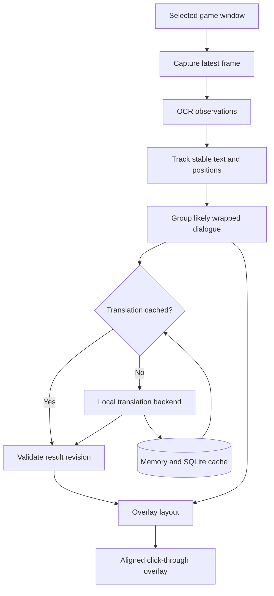

# Agreed product plan

Build an easy-to-run Windows desktop app that captures a selected game, detects Japanese text,
tracks it across frames, translates stable changes locally, and draws English over the original
text using readable translucent boxes. Target an ordinary 16 GB PC. A powerful development PC
must not determine the default resource requirements.

## User experience

- Select a game window, start or pause, and adjust overlay opacity.
- Prefer windowed or borderless fullscreen operation. Display capture is a later fallback.
- Use one click-through, nonactivating overlay aligned to the game client area.
- Hide the overlay when the target minimizes, disappears, or loses foreground focus.
- Add a hold-to-show-original hotkey and per-game profiles as the product develops.
- Text size has an Automatic checkbox, enabled by default. Estimate source glyph height and
  line spacing per region; measure English with the real renderer, wrap, then allow limited size
  adjustment. Keep sizing stable between frames. Respect a readability floor and expand or use
  nearby placement for overflow. Manual size and optional per-game calibration remain available.
- English may be longer than Japanese; exact original font reconstruction is not promised.

## Pipeline and state

Capture around four samples per second into a bounded latest-frame buffer. OCR returns text,
geometry, confidence, and orientation. Tracking associates observations using position, overlap,
appearance, and text history. Translation runs only for stable new or changed text. Rendering
uses current geometry independently of translation frequency.

Maintain separate frame, observation, text-track, dialogue-block, and translation-entry structures. Translation
results carry session, track, content revision, and engine generation identifiers. Reject stale
results after a source change, text change, scene transition, or model switch.

Typewriter dialogue initially stabilizes for approximately 250–400 ms. Group lines belonging to
one utterance while preserving speaker names, choices, and unrelated menu items. These values
are starting hypotheses to benchmark. Crop comparisons may avoid redundant OCR but must not
replace periodic validation or discovery of new text. Moving backgrounds must not be confused
with changed text.

## Local engines and caching

- Benchmark MeikiOCR first, PaddleOCR as a broader alternative, and specialist recognizers if needed.
- Japanese to English is the first supported language pair. Other languages require suitable OCR
  and translation backends.
- Evaluate Sugoi V4 through CTranslate2 as a compact candidate, subject to the exact weights' use
  terms. CTranslate2 executes local files on CPU or supported GPU hardware.
- Personal quality matters more than making every model redistributable. Keep code and weights
  separate. Private use does not automatically resolve research-only license restrictions.
- Compare at least one compact model and an optional larger local model using representative game
  text. Select by quality, omissions, terminology, latency, RAM, and VRAM; do not assume V4 is best.
- Support model changes through a translation interface with backend-specific adapters. Different
  formats may require different runtimes. Drain safely, reject old results, unload, load, warm up,
  and resume with current text. Do not double memory consumption during default switching.
- Use a bounded in-process cache backed by SQLite. Include model/tokenizer revision, language
  pair, glossary, decoding settings, and relevant context in cache identity. Combine identical
  in-flight work. Redis is deferred until a demonstrated shared-cache requirement exists.
- Model setup can download or import files explicitly. Normal processing must work offline.

## Capture and overlay modes

Windows Graphics Capture of a specific HWND is the first backend. Keep capture and rendering
separate. A graphics hook produces pixels, not semantic text, and would require native DX11/DX12
work. A native hook is optional future work for explicitly supported games, never an automatic
attempt to overcome protected capture. Publisher approval and actual game compatibility are
separate from whether a demo or other application works.

Exclude our own overlay from supported capture paths and verify clean source images. Handle
client borders, physical pixels, DPI, movement, resize, minimize, focus, and source closure.
Exclusive fullscreen, HDR, and mixed-DPI multi-monitor behavior require specific validation.

## Engineering approach

Use Python, PySide6, native capture/inference libraries, and deep modules with clear ownership.
Keep interfaces small and code composable without arbitrary function length rules or unnecessary
layers. Establish a root AGENTS.md, an engineering guide, decisions, verification commands, and
replay fixtures. Fast tests run without games or model downloads. Live checks exercise native
boundaries separately. Keep resources bounded and errors recoverable.

## Budgets and milestones

Budgets are targets, not measured claims: about 2 GB steady-state application RAM for the compact
configuration, about 2 GB additional VRAM for optional compact acceleration, 0.5–1 second typical
short-dialogue latency, and a 1.5 second p95 starting target. Larger quality presets have separate
budgets. Measure game frame times as well as isolated inference. See [performance](performance.md).

1. Select a window, capture clean client images, draw a correctly aligned click-through overlay.
2. Compare OCR on dialogue, menus, small text, furigana, and animated backgrounds.
3. Compare local translation models and confirm model distribution/use options.
4. Build deterministic tracking and stale-result rejection using replay sequences.
5. Connect the complete live translation pipeline.
6. Add automatic text sizing, profiles, glossary, hotkeys, model setup, and packaging.
7. Expand compatibility and consider a native hook only if justified.

Window capture, MeikiOCR inspection, and deterministic tracking are implemented. At the user's
request, Sugoi V4 integration now connects the live pipeline, including memory/SQLite caching,
swappable backend factories, and automatic/manual English sizing. See
[translation slice](plans/004-local-translation.md). This pulls parts of milestones three, five, and six
forward; it does not establish Sugoi as the best model. Representative model comparisons,
richer dialogue context, collision-aware placement, per-game profiles, glossaries, hotkeys, and packaging
remain upcoming work.

After positive real-game translation feedback, the user requested confidence-aware handling of
near-identical OCR variants. [Slice five](plans/005-confidence-stability.md) holds the better reading
and its geometry through weaker alternatives, with bounded confirmation for genuine similar edits.

[Slice six](plans/006-dialogue-grouping.md) now derives text bounds from character observations,
filters likely isolated icon glyphs, and groups likely wrapped dialogue into one translation and
overlay block. Raw evidence stays inspectable. Grouping is conservative and can be disabled; it
does not yet identify game panel boundaries or retain conversation history.

[Slice seven](plans/007-evidence-based-persistence.md) replaces age-based disappearance with
completed-observation and pixel evidence, preserves existing tracks under dense detector reordering,
and exposes processing/queue diagnostics. Capture remains four samples/second; dense workloads
are measured separately from the synthetic dialogue fixture.

[Slice eight](plans/008-responsive-ocr.md) adds reveal-aware dialogue readiness, early continuation
grouping, and optional NVIDIA CUDA OCR with CPU fallback. Capture pacing is now selectable from
2–8 samples/second (CPU defaults to four; GPU auto to six). A bounded local CUDA cache avoids
repeated first-use compilation. Other GPU vendors and translation GPU acceleration are deferred.

[Slice nine](plans/009-visual-evidence.md) adds bounded visual checks between capture and OCR. Changes
and settling schedule full inference; strong text-pattern loss masks closed panels before OCR can
confirm removal. Expanded reading areas detect continuation growth before the next OCR result, and
revealed multi-sentence paragraphs can stay grouped. Capture defaults to eight checks/second while
OCR is adaptive. Region-only inference and learned panel detection remain future improvements.
The follow-up from the stationary character-screen video also gates OCR reconciliation per accepted
visual region, bounds low-confidence reviews, and publishes corrections without an empty overlay gap.

[Slice ten](plans/010-regional-ocr.md) runs local OCR on changed regions with independent periodic
full discovery. Explicit coverage preserves unscanned text; dialogue confirmation retains per-line
source evidence across partial scans. CUDA batch padding removes shape-switching stalls, and native
verification measures newly appearing labels through English publication.

[Slice eleven](plans/011-gemma-and-diagnostics.md) adds an optional Gemma 4 E2B QAT backend through
embedded llama.cpp because CTranslate2 does not support this variant. Sugoi remains the compact CPU
choice. GPU translation, bounded non-reasoning prompts, and model-specific caches are implemented.
The debug checkbox shows visual changes, actual OCR coverage, and worker/cache/queue timings without
changing scheduling. Its initial implementation did not retain previous dialogue.

[Slice twelve](plans/012-model-management-and-context.md) adds model downloads/repair in the GUI,
an installed-model dropdown with capture-only operation, explicit Gemma preparation consent and
progress, and two turns of bounded recent-dialogue context with independent menu labels. An isolated
AMD-compatible Vulkan setup and source sharing package are available. CPU OCR remains the AMD
default; DirectML OCR failed numerical checks locally and is experimental with visible CPU fallback.
Discrete Radeon testing, permanent terminology/glossaries, and a frozen installer remain future work.

[Slice thirteen](plans/013-in-app-runtime-setup.md) adds explicit in-app runtime detection,
installation, progress, repair and restart. [Slice fourteen](plans/014-ui-proposal.md) implements
the approved compact main window, separate Settings, persistent preferences and optional Advanced
inspector. Hidden or paused inspection does not interrupt the live translation pipeline.

## Technical references

- [Windows capture](https://learn.microsoft.com/en-us/windows/apps/develop/media-authoring-processing/screen-capture)
- [Window capture library](https://github.com/NiiightmareXD/windows-capture)
- [Capture exclusion](https://learn.microsoft.com/en-us/windows/win32/api/winuser/nf-winuser-setwindowdisplayaffinity)
- [MeikiOCR](https://github.com/rtr46/meikiocr)
- [CTranslate2](https://opennmt.net/CTranslate2/)
- [Sugoi V4 weights and license](https://huggingface.co/entai2965/sugoi-v4-ja-en-ctranslate2)
- [Sugoi 14B Ultra candidate](https://huggingface.co/sugoitoolkit/Sugoi-14B-Ultra-GGUF)
